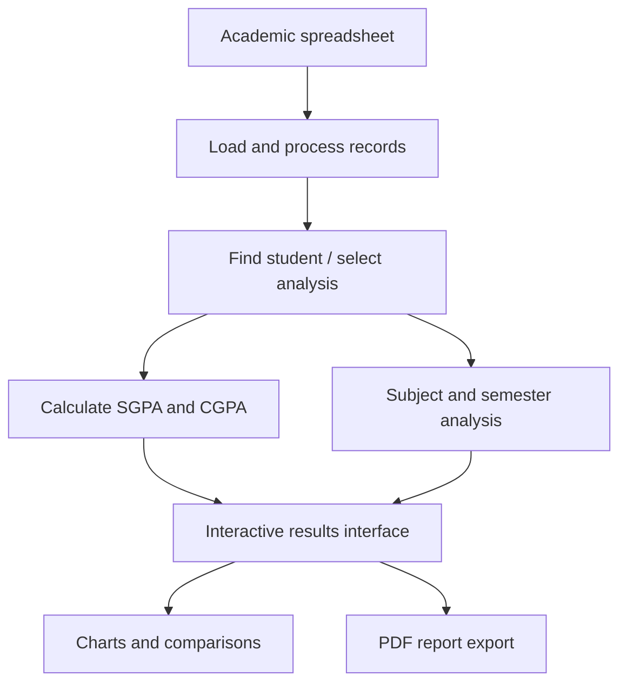
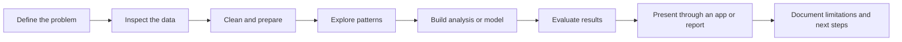

# Prahit Viraaj Reddy — Data Science Portfolio

**Python · SQL · Data Analysis · Machine Learning · Power BI**

I’m a final-year B.Tech student in **Artificial Intelligence & Data Science** at St. Mary’s Group of Institutions, Hyderabad. I build practical data applications and ML projects, with an emphasis on the full workflow: understanding the problem, preparing data, evaluating results, and making the output usable.

[GitHub](https://github.com/PrahitViraajReddy) · [LinkedIn](https://linkedin.com/in/prahit-viraaj-reddy-madupu-5169332ba) · [Email](mailto:prahitviraajreddym@gmail.com)

---

## Portfolio status

| Focus | Current direction |
|---|---|
| Primary career goal | Data Scientist |
| Adjacent roles | Data Analyst · BI Analyst |
| Core tools | Python · SQL · Pandas · NumPy · Scikit-learn |
| Applications & reporting | Streamlit · Power BI · Excel · Plotly |
| Project approach | End-to-end implementation, transparent evaluation, documented limitations |

This profile is a project index. Each project repository remains the source of truth for implementation, dependencies, evaluation details, and setup instructions.

---

## Featured work

### 1. Results — Academic Results Analytics Portal

**An interactive application for exploring academic performance.**

[**Launch live app →**](https://academic-results.streamlit.app/) · [**Read source code →**](https://github.com/PrahitViraajReddy/Results)

**Problem**

Academic results are often spread across tabular records, making it harder to look up an individual result, understand semester progress, or compare performance.

**What the application supports**
- Student result lookup using a hall-ticket number
- SGPA and CGPA calculations
- Subject-wise performance analysis
- Semester progression and interactive charts
- Student-to-student comparison
- Excel-based data processing
- PDF report generation

**Implementation**

| Layer | Tools |
|---|---|
| Data handling | Python · Pandas · OpenPyXL |
| Application | Streamlit |
| Charts | Plotly |
| Reports | ReportLab |

**Workflow**

**Status:** Deployed. Use the live app to explore the interface; consult the repository for implementation details.

---

### 2. Global Weather Classifier

**A machine-learning application for classifying weather conditions from structured weather data.**

[**Launch live app →**](https://prahitviraajreddy-global-weather-classifier-app-vnr7xd.streamlit.app/) · [**Read source code →**](https://github.com/PrahitViraajReddy/Global-Weather-Classifier)

**Project workflow**
1. Prepare and inspect the weather dataset.
2. Explore distributions and relationships.
3. Prepare features for machine learning.
4. Train and compare classification models.
5. Evaluate performance and expose predictions through an interactive app.

**Recorded scale and result:** Approximately **116,933 rows** and **0.71 balanced accuracy** in the project’s recorded evaluation. The repository should be consulted for the evaluation setup and metric context; this figure is not a guarantee for unseen data.

**Stack:** Python · Pandas · NumPy · Scikit-learn · Streamlit

**Status:** Deployed.

---

### 3. Car Price Prediction

**A regression project for estimating used-car prices from vehicle attributes.**

[**Read project and documentation →**](https://github.com/PrahitViraajReddy/Car-Price-Prediction)

**What it covers**
- Data preparation and feature engineering
- Regression-model comparison
- Evaluation with R², MAE, and RMSE
- Feature-importance analysis
- A Streamlit-based prediction interface

**Stack:** Python · Pandas · NumPy · Scikit-learn · Streamlit

**Status:** Repository and README available. The project README documents reported model results and local setup.

---

### 4. Familybook

**A family information application with relationship visualisation and personal records.**

[**Open live app →**](https://familybook-7ff4.onrender.com/) · [**Read source code →**](https://github.com/PrahitViraajReddy/Familybook)

**Features**
- Family profiles and relationship visualisation
- Photo albums
- Diary and timeline features
- Interactive application interface

**Stack:** Python · Streamlit · SQL

**Status:** A deployed link is available; service availability may vary.

---

## Project comparison

| Project | Domain | Main technical work | Demo |
|---|---|---|---|
| Results | Academic analytics | Data processing, calculations, charts, PDF export | [Live](https://academic-results.streamlit.app/) |
| Global Weather Classifier | Machine learning | Classification, feature preparation, evaluation | [Live](https://prahitviraajreddy-global-weather-classifier-app-vnr7xd.streamlit.app/) |
| Car Price Prediction | Machine learning | Regression, model comparison, feature importance | [Repository](https://github.com/PrahitViraajReddy/Car-Price-Prediction) |
| Familybook | Data application | Structured records, relationships, interactive UI | [Live](https://familybook-7ff4.onrender.com/) |

---

## Technical toolkit

| Category | Tools and concepts |
|---|---|
| Programming | Python |
| Querying | SQL |
| Data analysis | Pandas · NumPy · Data cleaning · Exploratory Data Analysis |
| Statistics & ML | Statistics · Feature engineering · Scikit-learn · Regression · Decision trees · Random forests · Model evaluation |
| BI & visualisation | Power BI · DAX · Excel · Tableau · Plotly · Matplotlib · Seaborn |
| Data storage | MySQL · PostgreSQL |
| Apps & workflow | Streamlit · Git · GitHub |

---

## How I approach a data project

I aim to make projects understandable and reproducible, rather than presenting a model score without context. Metrics depend on the dataset, split strategy, target definition, and evaluation method; each project’s repository is the place to inspect those details.

---

## Current development priorities

- **SQL:** joins, aggregations, subqueries, CTEs, window functions, and analytical problem-solving
- **Statistics:** distributions, sampling, hypothesis testing, and interpretation
- **Machine learning:** sound validation, leakage prevention, baselines, and error analysis
- **BI:** Power BI, DAX, and communicating business-relevant findings
- **Project quality:** reproducible setup, clear documentation, useful interfaces, and honest limitations

---

## Roadmap

| Priority | Goal |
|---|---|
| 1 | Strengthen SQL and core analytical reasoning |
| 2 | Improve statistical foundations and ML evaluation |
| 3 | Build stronger end-to-end data science case studies |
| 4 | Improve dashboards and business-facing communication |
| 5 | Keep projects documented, reproducible, and easy to run |

---

## Connect

- **LinkedIn:** [Prahit Viraaj Reddy](https://linkedin.com/in/prahit-viraaj-reddy-madupu-5169332ba)
- **GitHub:** [PrahitViraajReddy](https://github.com/PrahitViraajReddy)
- **Email:** [prahitviraajreddym@gmail.com](mailto:prahitviraajreddym@gmail.com)

---

*Learning by building — turning data into useful analysis, evaluated models, and practical applications.*
